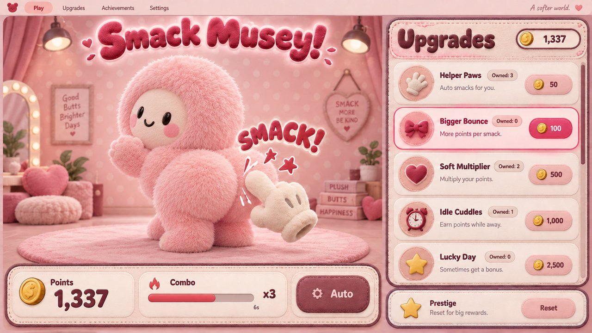

# Smack Musey!

The Meta Muse mascot has a very smackable butt. You have a plush hand. You know what to do.

**[▶ Play it live](https://jquave.github.io/smack-musey/)**



## How to play

- **Click / tap** Musey's butt to smack it.
- **Swing** your hand through his butt really fast — a fast swing lands a smack without clicking, and the faster you swing, the harder it smacks (louder, higher-pitched, jiggler).
- Chain smacks quickly to build a **combo**. Milestones at 1, 10, 25, 50, 100, 250, 500 and 1,000 smacks.
- **Alternate cheeks** to charge **Perfect Balance**: eight alternating hits make your manual smacks pay ×5 for 6 seconds. Both cheeks must be heard.
- Every smack earns **Smack Points**. Spend them in the **Upgrades shop**: stronger palms, auto-smackers that work while you watch (and at half rate while you're gone for up to 8 hours), crits, echoes, multipliers — 18 upgrades, buyable x1/x10/Max. Every income card shows its estimated `+pts/s` and payback time at your recent pace, with the current best value highlighted. Auto-smackers appear only as brief strikes from the same white plush glove, one at a time; the glove itself never changes.
- Rich? **Prestige**: reset points and upgrades for Butt Stars. Each total star is worth +15% points forever, and available stars can also buy permanent **Star Perks** — a seeded next run, Muscle Memory, better offline earnings, earlier Frenzy, Brand Synergy, or a Board of Directors that optionally auto-buys the best-value upgrade.
- Richer? Buy **Heat Death R&D**, then the **Heat Death Palm**. Your next smack triggers **Universe Reload**: points, upgrades, Butt Stars and Star Perks reset, you gain permanent Primordial Fluff, and every completed universe permanently doubles all points. Welcome to Universe #2.
- Keyboard: focus Musey and press **Space**. The hand does the rest.
- Your smack count, points, upgrades, stars, universes and Fluff are saved in your browser.

## Features

- Spring-physics jiggle: each cheek is an independent damped spring with directional squash, skew, sway and rebound; the far cheek ripples 45 ms after the hit one, the whole body recoils, and his head wobbles a beat later.
- Velocity-sensitive smacks with pitch/volume-matched sound; combos climb the pitch ladder, every individual smack gets small pitch and duration variation, and the hardest hits get a subtle low thump, screen shake and a freeze-frame.
- Auto-smackers stay out of the scene until they strike: one white plush glove darts in, lands a quieter hit and leaves. Even at extreme auto rates, that single strike simply represents a larger batch — there is never more than one auto glove on screen.
- **Perfect Balance** turns cheek choice into a skill: alternate left/right to fill the slim L/R meter, then cash in ×5 manual points.
- Three shop tabs keep the long game tidy: run **Upgrades**, permanent **Star Perks**, and eternal **Universe** perks bought with Primordial Fluff.
- **Universe Reload** is the second prestige layer: a short skippable cosmic reset, a persistent Universe # in the tagline and score link, ×2 points per completed universe, and Fluff perks such as Déjà Vu, Cosmic Palm, Deep-Time Hands and Eternal Balance.
- Lingering pink handprints, impact particles, rings, escalating pop words ("SMACK!", "THWACK!!", "KRAKOOM!"), a cheek that visibly reddens, and confetti bursts at milestones.
- **SMACK FRENZY** at an x8 combo (x6 with Hostile Takeover): the page heats up and the title starts wiggling. There's also a hardest-smack record, a combo timer bar, and a share-score button.
- He's alive: Musey breathes idly, and if you ignore him for 7 seconds the butt wiggles invitingly. Clicks elsewhere on his body get a soft plush "boop"; missed swings whoosh.
- Custom plush hand cursor that tilts with your swing, winds up on click, and leaves motion-trail ghosts at high speed.
- Works with mouse, touch and keyboard; respects `prefers-reduced-motion`.

## Deploy to GitHub Pages

This is a plain static site — no build step, no dependencies, all paths are relative so it works from any sub-folder.

```bash
git init
git add .
git commit -m "Smack Musey"
git branch -M main
git remote add origin git@github.com:jquave/smack-musey.git
git push -u origin main
```

Then in the repo: **Settings → Pages → Build and deployment → Deploy from a branch → `main` / `/ (root)` → Save.** The site is live at https://jquave.github.io/smack-musey/ (already deployed; these steps are for redeploying from scratch).

## Run locally

Any static server works, for example:

```powershell
python -m http.server 8321
```

Then open `http://127.0.0.1:8321/` in a browser.

## Files

| File | What it is |
|---|---|
| `index.html`, `style.css`, `app.js` | The whole app. |
| `assets/musey-cutout.webp` / `.png` | Musey with the white backdrop removed, so he sits on the page color. |
| `assets/hand.png`, `assets/hand-cursor.png` | The plush hand (edges cleaned, scaled down) + tiny native-cursor fallback. |
| `assets/smack.ogg` / `.wav` | The isolated smack (see below). WAV is the Safari fallback. |
| `assets/musey.jpg` | Social-preview image. |
| `assets/icons/*.webp` | The 17 generated upgrade icons + points coin, sliced from the sheet below; later perk cards reuse the closest matching icon. |
| `assets/gen/upgrade-icons-sheet.png` | Codex imagegen sprite sheet the icons were sliced from (green-screen source). |
| `assets/gen/ui-concept.png` / `.jpg` | Codex imagegen UI concept the shop design follows. |
| `assets/gen/tex-fur-pink.*`, `tex-cream-dots.*` | Codex imagegen seamless plush textures used by the shop and cards (`.webp` served, `.png` master). |
| `tests/check_*.py` | Headless-Chrome checks for input lag, layout stability, economy, audio/auto visuals, and share links. |

The three original files in the repo root (`musey.jpg`, `Ivory plush hand cursor.png`, the original `.ogg`) are the unprocessed sources. The site doesn't need them — keep them for safekeeping or delete them before pushing.

## About that smack sound

The original recording (`223492__mrgreaper__bunny-smack-bad-human.ogg`) is 2.3 s long: some rustling, then one glorious crack at 0.41 s, then the aftermath. The isolated clip in `assets/` is just that first crack — cut at 0.4095 s, before the following sounds start, with a short exponential fade on the tail and the peak normalised to 0.95 (the original slightly clipped). Length: 92.5 ms of pure smack.

Sound credit: "bunny smack bad human" by **mrgreaper**, Freesound #223492.

## Disclaimer

Musey is the Meta Muse mascot. No Museys were harmed; he is plush and he loves it. This is a fan-made joke, not affiliated with or endorsed by Meta.
